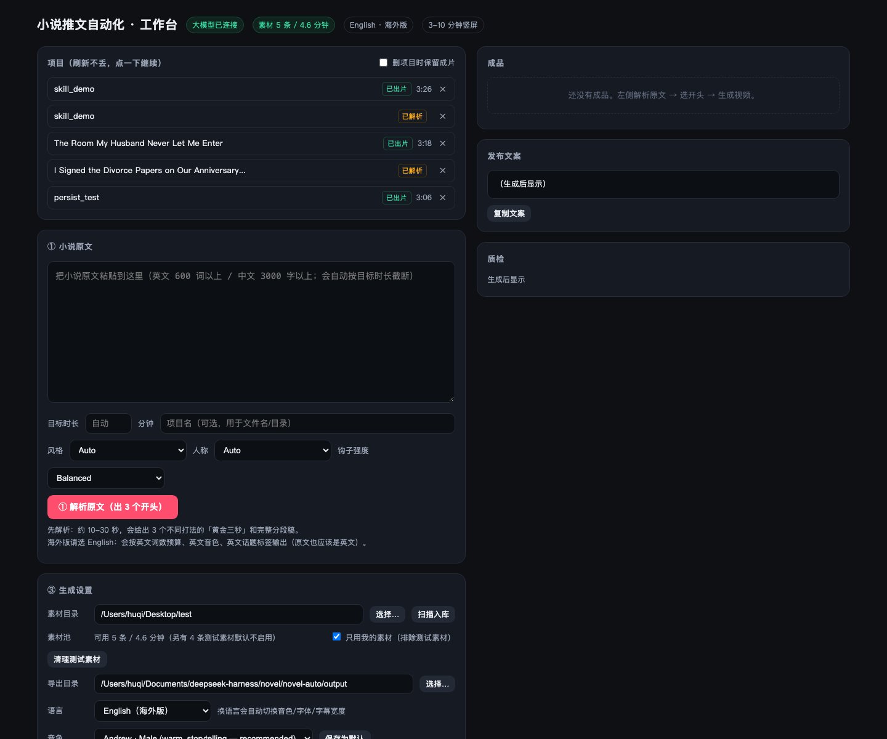

# novel-auto · AI novel-to-short-video pipeline

[](LICENSE)
[](https://www.python.org/)

Turn a novel chapter into a **3–10 minute vertical video with narration, subtitles, b-roll and publish copy** — fully automated, reviewable at every step.

```
source text
  → script rewrite (3 hook variants + chapter cliffhangers + duration convergence)
  → TTS narration (Edge TTS default; Volcengine / MiniMax supported)
  → timeline (real audio lengths, ms level)
  → subtitles (Pillow-rendered transparent PNGs, auto line wrap, fade in/out)
  → b-roll selection (fingerprint dedupe, cooldown, anti-duplicate params)
  → render (segmented render, Ken Burns, color grade, overlay, mixdown, concat)
  → publish kit (cover, 3 title options, hashtags, pinned comment, upload checklist)
  → QA (duration / resolution / LUFS / black frames / silence / A-V sync / hook density)
```

Built for long-form storytelling instead of 30-second clips: chapter-by-chapter retention hooks, automatic duration convergence to a target length, and a two-phase flow (rewrite first, pick a hook, then render) that keeps TTS cache reusable across re-renders.



## Highlights

- **Two-phase pipeline** — `prepare` (rewrite + 3 hook variants, 10–30 s) and `render` (video, re-runnable per chosen hook)
- **Duration control** — target 3–10 min with tolerance; the script is tightened or expanded until the rendered length converges
- **ffmpeg without libass?** subtitles are rendered with Pillow to transparent PNGs, so it works on stock macOS/Homebrew ffmpeg
- **Asset library** — SQLite index, perceptual fingerprint dedupe, per-clip cooldown, reuse caps, synthetic placeholders for first-run testing
- **Local web console** — FastAPI + vanilla JS: project list, editable segments, per-project voice/rate/style, live progress, download
- **Quality report** — `qa_report.txt` with pass/warn per check, plus `meta.json` for automation
- **Chinese + English** — language switch changes prompts, word budgets, voices, fonts, subtitle wrapping, hashtags

## Quick start

```bash
cd novel-auto
python3 -m venv .venv && source .venv/bin/activate
pip install -r requirements.txt
cp .env.example .env                      # add LLM_API_KEY (DeepSeek API by default)
./.venv/bin/python -m novelauto doctor    # checks ffmpeg / key / fonts
./.venv/bin/python -m novelauto web       # opens the console on 127.0.0.1
```

No footage yet? Generate placeholder clips to try the full pipeline:

```bash
./.venv/bin/python -m novelauto assets synth --count 3 --seconds 90
```

CLI only:

```bash
./.venv/bin/python -m novelauto prepare -i samples/sample_story_en.txt --minutes 4 --language en
./.venv/bin/python -m novelauto render  --job-id <job_id> --hook 2
```

## Repository layout

| Path | What |
|---|---|
| `novel-auto/` | Runnable project: `novelauto/` package, FastAPI console, launchers — see [novel-auto/README.md](novel-auto/README.md) |
| `novel-auto/novelauto/` | Pipeline modules: `scriptwriter`, `tts`, `audio`, `subtitles`, `assets`, `render`, `publish`, `qc`, `pipeline`, `web` |
| `小说推文自动化方案-v2.md` | Design doc (Chinese): pipeline, retention hooks, duration convergence, QA, cost |
| `参考方案对比与借鉴清单.md` | Comparison against a reference spec (Chinese) |
| `.dsh/skills/novel-promo/` | DSH skill so an agent can drive the pipeline conversationally |

## Not in the repo

`.venv/`, `work/`, `output/`, `.cache/`, `assets/clips/` (your footage) and `.env` (API keys) are git-ignored — only code, docs and sample text live here.

## 中文简介

输入一段小说原文，自动产出 3–10 分钟竖屏成品视频（配音 + 字幕 + 素材 + 动效）与发布文案包，默认英文海外版，可切中文。

核心设计：两阶段流水线（先改写、选开头，再渲染，TTS 缓存可复用）、章回续航钩子、时长自动收敛、无 libass 环境也能烧字幕、素材库防撞车选片、逐项质检报告。

详细用法见 [novel-auto/README.md](novel-auto/README.md)，工程方案见 [小说推文自动化方案-v2.md](小说推文自动化方案-v2.md)。

## License & content notice

Code is MIT licensed (see `LICENSE`). Novel text, TTS voices and footage remain the property of their respective owners — bring your own licensed content; this repository ships no media.
